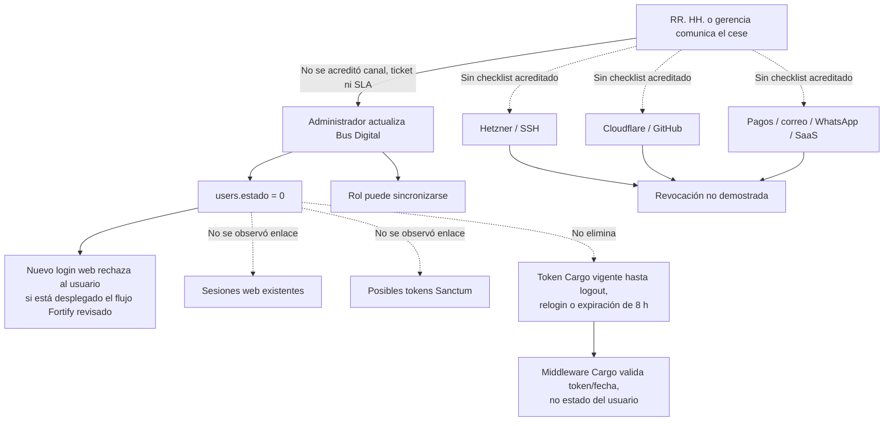
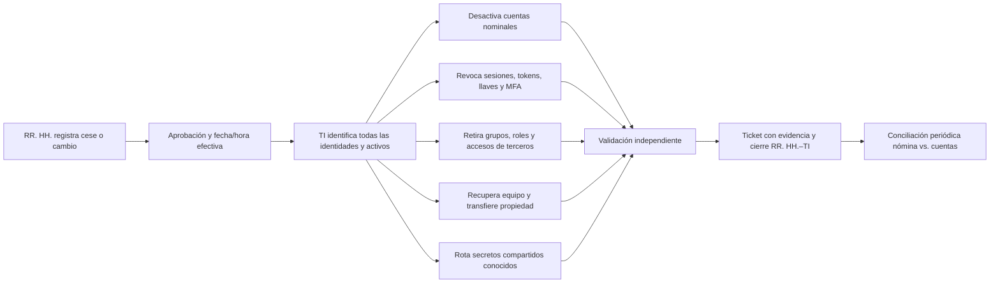

# Ciberseguridad — ETAPA 3: PR · Proteger accesos

**Empresa:** AM Digital Web E.I.R.L.  
**Sistema crítico de referencia:** Bus Digital / instalación TopPeru  
**Controles:** PR-01 a PR-06 del Taller 03  
**Fecha de corte:** 20 de octubre de 2026  
**Clasificación:** CONFIDENCIAL  
**Tipo de revisión:** documental y de código fuente local; sin conexiones ni verificaciones activas

## 1. Objetivo y límites

Esta etapa evalúa la evidencia disponible sobre autenticación multifactor, privilegios administrativos, ciclo de vida de usuarios, cuentas compartidas, concientización y simulaciones de phishing. Profundiza los antecedentes de desactivación de usuarios, el acceso de Cargo, Laravel Sanctum y la administración de roles de Bus Digital.

No se ejecutaron intentos de ingreso, pruebas de credenciales, recuperación de contraseñas, creación o modificación de usuarios, emisión o reutilización de tokens, consultas de base de datos, conexiones SSH/VPN, accesos a consolas, revisión de cuentas reales ni campañas de phishing. Tampoco se inspeccionaron configuraciones productivas.

Una característica presente en el repositorio se registra como **funcionalidad declarada en código**. Solo se considera **control implementado por la empresa** cuando existe evidencia de aprobación, configuración vigente, cobertura, responsables y operación trazable. El informe del Taller 02 es un antecedente técnico y no se transforma en una política o control corporativo aprobado.

### Escala de evaluación

| Resultado | Significado |
|---|---|
| ACREDITADA | Evidencia suficiente, vigente y trazable de la dimensión evaluada. |
| PARCIALMENTE ACREDITADA | Evidencia real, pero incompleta, informal, histórica o limitada a una parte del alcance. |
| NO ACREDITADA | No se proporcionó evidencia suficiente. No prueba por sí sola que el control no exista. |
| NO EVALUABLE | La evidencia permite identificar la superficie, pero no decidir su funcionamiento real. |

Para esta etapa, la **existencia formal** requiere política/procedimiento aprobado, responsable y alcance definido. La **operación efectiva** requiere configuración o ejecución vigente, cobertura demostrable, revisión periódica y muestras fechadas.

## 2. Fuentes revisadas y valor probatorio

| Ref. | Fuente | Uso en esta etapa | Reserva |
|---|---|---|---|
| P-01 | `ASTI - Taller 03 - Ciberseguridad.docx` | Criterios PR-01 a PR-06 y reglas éticas. | Guía académica; no es evidencia de AM Digital. |
| P-02 | `Ciberseguridad_00_Preparacion.md`, `Ciberseguridad_01_Gobernar.md` y `Ciberseguridad_02_Identificar.md` | Alcance, gobierno, activos, terceros y exposición declarada. | Documentos de trabajo basados en evidencia disponible. |
| P-03 | `Informe_Auditoria_BusDigital_EPIS_Actualizado.docx` | Antecedentes del Taller 02 sobre Fortify, Jetstream, Sanctum, roles y baja de usuarios. | Revisión estática; no acredita configuración ni datos de producción. |
| P-04 | `Informe Final.pdf` de prácticas preprofesionales | Accesos observados entre enero y junio de 2026, inducción, herramientas y administración de infraestructura. | Informe académico, no procedimiento aprobado ni evidencia actual al corte. |
| P-05 | `reporte_simple_pentest_topperu.docx` | Antecedente histórico sobre autenticación de Cargo. | Borrador académico del 14/06/2026; fuente secundaria, sin retest en esta etapa. |
| P-06 | Repositorio local `/home/erivero96/Desktop/TopPeru` | Revisión estática de autenticación, roles, usuarios, tokens y rutas. | El código no demuestra despliegue, configuración, datos, uso ni eficacia en producción. |

Se omitieron contraseñas, tokens, claves, identificadores personales, direcciones de servicios y ejemplos sensibles. No se abrió ni usó material de autenticación para conectarse a sistemas.

## 3. Resumen ejecutivo PR-01 a PR-06

| Control | Existencia formal | Operación efectiva | Conclusión documental |
|---|---|---|---|
| PR-01 · MFA | NO ACREDITADA | NO EVALUABLE | Fortify declara 2FA para el acceso web, pero no se acreditan obligatoriedad, enrolamiento ni cobertura. No hay evidencia de MFA en correo, nube, GitHub, Cloudflare, paneles de pago, SSH o accesos administrativos; no existía VPN corporativa en P-04. |
| PR-02 · Privilegios locales y cuentas privilegiadas | NO ACREDITADA | NO ACREDITADA | Se observaron accesos de alto privilegio entregados informalmente a practicantes, pero no inventario, separación de cuentas, aprobación, mínimo privilegio ni recertificación. Los administradores locales de equipos siguen sin identificar. |
| PR-03 · Altas, bajas y modificaciones | NO ACREDITADA | PARCIALMENTE ACREDITADA | El código permite alta, cambio de rol, cambio de contraseña y desactivación. El nuevo login web valida `estado`; Cargo no lo valida y no aparece revocación integral de sesiones/tokens o accesos externos. No se acredita flujo RR. HH.–TI. |
| PR-04 · Cuentas genéricas o compartidas | NO ACREDITADA | NO ACREDITADA | La aplicación exige nombre y correo únicos al crear usuarios, pero no existe inventario corporativo de cuentas genéricas. P-04 describe entrega informal de credenciales y dificultad para revocarlas, incluida infraestructura y paneles críticos. |
| PR-05 · Concientización | NO ACREDITADA | NO ACREDITADA | No se encontró programa anual, inducción de seguridad, asistencia, evaluación ni cobertura de gerencia. P-04 documenta una inducción técnica informal y autoaprendizaje. |
| PR-06 · Simulaciones de phishing | NO ACREDITADA | NO ACREDITADA | No hay política, autorización, campañas, métricas ni tratamiento documentado. No se realizó ninguna simulación. |

**Resultado:** ninguno de los seis controles acredita simultáneamente existencia formal y operación efectiva. La evidencia más concreta es técnica y parcial: autenticación web con soporte de 2FA, control de estado para nuevos inicios web, roles/permisos en la aplicación y tokens Cargo con caducidad. Esto no reemplaza gobierno de identidades, MFA corporativo ni un proceso de baja extremo a extremo.

## 4. Funcionalidad declarada frente a control empresarial

| Elemento | Lo que declara el código | Lo que puede afirmarse de la empresa | Evidencia faltante para considerarlo control implementado |
|---|---|---|---|
| Fortify 2FA | `config/fortify.php` habilita autenticación de dos factores, confirmación y recuperación; existe limitador de 5 intentos/minuto para login y desafío 2FA. | Bus Digital **puede** soportar 2FA en su canal web. | Captura/configuración mostrada por TI, política de obligatoriedad, usuarios enrolados, cobertura de administradores, excepciones, recuperación y prueba de revisión. |
| Login web y `estado` | `JetstreamServiceProvider` autentica por correo, documento, nombre o teléfono y exige contraseña válida y `estado == 1`. | Un nuevo login por ese flujo debería rechazar usuarios inactivos si este código está desplegado. | Versión desplegada, rutas reales de autenticación, prueba autorizada o logs sanitizados y confirmación de todos los canales. |
| Sesión web / Sanctum | Rutas de mantenimiento usan `auth:sanctum`, `jetstream.auth_session` y `verified`; `User` incluye `HasApiTokens`. La interfaz de tokens API de Jetstream está deshabilitada y no se halló `createToken()` en el código revisado. | Sanctum participa en la protección declarada de rutas web; no se acredita uso de tokens personales. | Configuración productiva, sesiones vigentes, duración, cierre global, dispositivos, revocación y eventual inventario de tokens. |
| Estado de usuario | `UsuarioController` puede activar/desactivar y sincronizar el rol. | Existe una acción técnica de mantenimiento de usuarios. | Quién está autorizado, solicitud RR. HH., aprobaciones, bitácora, SLA, recertificación y evidencia de revocación en todos los sistemas. |
| Cargo | Login propio por contraseña; crea un token aleatorio, guarda su hash, elimina el token Cargo anterior del usuario y fija expiración de 8 horas. Logout elimina el token presentado. | Existe un mecanismo de token separado del login web. | Confirmación de despliegue, rate limiting, MFA, estado del usuario, alcance por rol, logs, revocación central y tratamiento de tokens activos. |
| Roles Spatie | El modelo usa `HasRoles`; el seeder declara `SuperAdmin`, `Admin`, `Trans. Moquegua` y `Comisionista` con permisos; usuario permite asignar/sincronizar rol. | Hay un modelo inicial de RBAC en el repositorio. No demuestra que esos sean los roles productivos ni que estén recertificados. | Exportación sanitizada de roles/usuarios/permisos, dueños, matriz aprobada, revisiones, segregación y muestra de autorizaciones. |
| Administración de usuarios | `UsuarioController` exige `permission:modulo_mantenimiento`, salvo `getUsuarios`; la creación exige nombre/correo únicos y un rol existente. | Existe autorización declarada a nivel de módulo para ese controlador. | Prueba de asignaciones reales, privilegio mínimo, registros y revisión periódica. |
| Administración de roles | Las rutas están en el grupo autenticado/verificado; `RolPermisoController` crea roles y sincroniza permisos. En la cadena revisada no se observó middleware granular propio del controlador para `view_rol`, `create_rol` o `update_rol`. | Hay una **brecha estática potencial** de autorización granular; no se probó explotabilidad ni despliegue. | Confirmar middleware global/capa adicional, listado de rutas productivas, pruebas unitarias de autorización y matriz de acceso aprobada. |
| Reglas de contraseña de mantenimiento | Alta y cambio administrativo validan contraseña como `required`; el mensaje de alta menciona un mínimo, pero la regla no lo aplica. | El flujo administrativo revisado no declara complejidad/mínimo equivalente a la regla Fortify. | Política corporativa, versión desplegada, validadores adicionales y procedimiento seguro de entrega/cambio inicial. |

### Interpretación específica de Sanctum

No debe asumirse que todo uso de `auth:sanctum` implica tokens API permanentes. En la configuración revisada, Sanctum consulta primero el guard web para solicitudes de primera parte; Jetstream tiene deshabilitada su función de administración de tokens API. Aunque la tabla `personal_access_tokens` y el trait `HasApiTokens` existen, no se encontró emisión de tokens con `createToken()` en el código revisado. La existencia o ausencia de tokens en producción solo puede confirmarse mediante evidencia mostrada por TI.

## 5. Matriz de identidades y accesos

| Población / superficie | Identidad y autenticación conocidas | MFA | Autorización / privilegio | Alta, cambio y baja | Estado y brecha |
|---|---|---|---|---|---|
| Usuarios web de Bus Digital | Tabla `users`; Fortify acepta correo/documento/nombre/teléfono más contraseña; nuevo login exige `estado == 1`. | Capacidad 2FA declarada; enrolamiento y obligatoriedad desconocidos. | Roles/permisos Spatie; cuatro roles sembrados como base, no inventario real. | Controlador crea, cambia contraseña, estado y rol. No se observa revocación de sesiones al desactivar/cambiar rol. | PARCIAL. Capacidad técnica sin proceso corporativo, cobertura ni evidencia productiva. |
| Administradores de usuarios | Mismo acceso web; controlador de usuarios requiere permiso de módulo. | Desconocido. | Puede crear usuarios, asignar/sincronizar roles y resetear contraseñas; regla administrativa de contraseña solo exige valor no vacío. | No hay aprobación dual, ticket, notificación al titular ni auditoría acreditados. | ALTO RIESGO si la asignación real es amplia. Requiere matriz y muestra de logs. |
| Administradores de roles/permisos | Rutas autenticadas/verificadas; controlador permite crear roles y sincronizar permisos. | Desconocido. | No se observó middleware granular específico en el controlador/rutas revisadas. | No se acredita revisión ni revocación de permisos después de cambios. | BRECHA ESTÁTICA POTENCIAL; validar sin intentar acceso. |
| Usuarios de API Cargo | Misma tabla `users`; login propio por contraseña y token bearer separado, con hash en BD y caducidad de 8 horas. | No se declara MFA en Cargo. | El middleware autentica al `user_id`; las rutas protegidas cubren numerosas operaciones de encomiendas. No se observó verificación de rol/permiso en el middleware común. | Login elimina token Cargo previo; logout/expiración lo elimina. Desactivar al usuario no aparece enlazado a la tabla Cargo y el middleware no revalida `estado`. | BRECHA RELEVANTE DE BAJA. Un token vigente podría seguir siendo aceptado según el código revisado; no se probó. |
| Sesiones web y posible Sanctum | Cookies/sesión del guard web en rutas `auth:sanctum`; infraestructura de tokens personales presente, emisión no hallada. | Hereda 2FA solo cuando el usuario lo tenga configurado y el flujo lo exija; cobertura desconocida. | Depende de roles/permisos de la aplicación. | No se halló eliminación central de sesiones o tokens al desactivar, cambiar rol o cambiar contraseña administrativamente. | Pendiente de datos/configuración productiva. No confundir infraestructura disponible con tokens emitidos. |
| Servidores Hetzner / SSH | P-04 describe acceso SSH directo y trabajo remoto sin VPN corporativa. Método exacto por usuario/llave no acreditado. | Sin evidencia. VPN no disponible en el periodo observado. | Practicantes realizaban administración básica y despliegues manuales; alcance `root`/`sudo` desconocido. | Entrega informal por WhatsApp/verbal; no hay inventario ni actas de revocación. | ALTO. Acceso privilegiado crítico sin gobierno acreditado. |
| Cloudflare / DNS | Cuenta(s) no identificadas; acceso otorgado al equipo según P-04. | Sin evidencia. | Capacidad potencial de modificar DNS/proxy/certificados; roles reales desconocidos. | Alta/baja informal; no se acredita cuenta de emergencia ni recuperación. | ALTO. Solicitar miembros, roles, MFA y logs, enmascarados. |
| GitHub / repositorios privados | P-04 describe repositorios privados y cuentas del equipo; tipo personal/organización pendiente. | Sin evidencia de obligatoriedad. | Miembros/owners y acceso por repositorio desconocidos. | No se acredita invitación/aprobación, recertificación ni remoción de cesados. | ALTO por código, historial y cadena de despliegue. |
| Paneles de pago Mercado Pago/Culqi | Accesos a paneles administrativos entregados al equipo; cuentas por cliente según P-04. | Sin evidencia. | Puede involucrar transacciones económicas; roles y separación por cliente desconocidos. | Entrega informal y revocación no documentada. | CRÍTICO. Confirmar propiedad, usuarios nominales, MFA y segregación. |
| Correo | P-04 indica que no se proporcionó correo corporativo a practicantes. Proveedor y cuentas actuales no acreditados. | No evaluable. | Recuperación de cuentas y comunicaciones podrían depender de cuentas personales; debe confirmarse. | Sin directorio ni baja acreditados. | No es posible evaluar MFA de correo sin plataforma e inventario vigentes. |
| VPN / acceso remoto corporativo | P-04 reporta ausencia de VPN y acceso SSH desde Internet durante el periodo observado. | No aplica a una VPN inexistente; esto no satisface PR-01/PR-14. | Restricciones alternativas no acreditadas. | Sin inventario de usuarios remotos. | BRECHA. Confirmar estado actual y controles compensatorios. |
| Estaciones de trabajo / administrador local | Aproximadamente 10 PCs según P-04; directorio, dominio y cuentas locales desconocidos. | No evaluable. | No hay relación de administradores locales ni separación de cuenta cotidiana/administrativa. | No se acredita alta/baja, LAPS/equivalente, contraseña única o revisión. | NO ACREDITADO. Prioridad alta por almacenamiento local de credenciales y acceso cloud. |
| WhatsApp y otras herramientas SaaS | WhatsApp fue canal interno principal; Asana, Figma y otros servicios fueron descritos. | Depende de cuentas personales/proveedor; no acreditado. | Grupos, administradores, contenido y propiedad desconocidos. | No hay checklist de salida ni transferencia de propiedad acreditados. | Riesgo de persistencia de acceso/información tras el cese. |

## 6. Evaluación detallada por control

### PR-01 · MFA en correo, nube, VPN y accesos administrativos

**Existencia formal:** **NO ACREDITADA.**  
No se proporcionó política de MFA, estándar de autenticación, inventario de plataformas cubiertas, excepciones, responsable ni fecha de cumplimiento. El Taller 02 solo identificó capacidad 2FA en el código.

**Operación efectiva:** **NO EVALUABLE.**  
Bus Digital declara Fortify 2FA, confirmación de contraseña y códigos de recuperación, pero no se conoce si está activado, si es obligatorio o qué porcentaje de usuarios está enrolado. No existe evidencia equivalente para correo, Hetzner, Cloudflare, GitHub, paneles de pago, cuentas administrativas o SSH. P-04 registró que no había VPN corporativa; por tanto, no puede evaluarse MFA de VPN como control operativo y debe evaluarse el acceso remoto directo.

**Evidencia:** P-03; P-04; P-06: `config/fortify.php`, `app/Models/User.php`, `app/Providers/FortifyServiceProvider.php` y `app/Providers/JetstreamServiceProvider.php`.

**Brecha:** una capacidad optativa de una aplicación no protege el conjunto de identidades privilegiadas. Faltan obligatoriedad para administradores, cobertura de recuperación, resistencia a pérdida de factor, cuentas de emergencia, métricas y revisión.

**Preguntas para la empresa:**

1. ¿Qué proveedor de correo y qué dominios corporativos están vigentes, y qué porcentaje de cuentas tiene MFA exigido?
2. ¿MFA es obligatorio para Hetzner, Cloudflare, GitHub, pagos, facturación, DNS y administradores de Bus Digital?
3. ¿Cuántos usuarios de Bus Digital tienen 2FA activo, separados por rol, sin revelar identidad ni secretos?
4. ¿Quién aprueba excepciones y cómo se gestionan recuperación, cambio de teléfono, códigos de respaldo y cuentas de emergencia?
5. ¿Existe hoy VPN/Zero Trust/allowlist para SSH u otros accesos administrativos? Si no, ¿qué control compensatorio se aplica?
6. ¿Se revisan alertas de desactivación de MFA, nuevos dispositivos y cambios de métodos de recuperación?

### PR-02 · Privilegios locales y cuentas privilegiadas

**Existencia formal:** **NO ACREDITADA.**  
No se encontró estándar de cuentas privilegiadas, inventario de administradores, matriz de mínimo privilegio, segregación entre cuenta diaria y administrativa, custodio de cuenta de emergencia, PAM ni frecuencia de recertificación.

**Operación efectiva:** **NO ACREDITADA.**  
P-04 documenta que tres practicantes participaban en administración Linux, Cloudflare, paneles de pago, repositorios y despliegues SSH, con accesos entregados informalmente. Esto acredita uso de privilegios, no su control. No se conocen administradores locales en las aproximadamente 10 estaciones ni `root`/`sudo`, owners de SaaS, administradores de BD o privilegios de producción.

**Evidencia:** P-04; P-06: `RoleSeeder.php`, `UsuarioController.php`, `RolPermisoController.php` y rutas de mantenimiento.

**Brecha:** concentración de privilegios críticos sin inventario, aprobación, trazabilidad o revisión demostrables. En la aplicación, `Admin` y `SuperAdmin` reciben permisos amplios por seeder, pero el estado real y la necesidad por puesto no están acreditados.

**Preguntas para la empresa:**

1. ¿Quiénes son administradores locales, `sudo/root`, owners de nube/repositorios y administradores de Bus Digital, BD, DNS y pagos?
2. ¿Cada acceso es nominal? ¿Se usa una cuenta distinta para tareas privilegiadas?
3. ¿Qué aprobación y justificación existen para cada privilegio y cuándo fue la última recertificación?
4. ¿Cómo se protegen y registran las cuentas de emergencia?
5. ¿Los practicantes o terceros conservan privilegios productivos? ¿Qué supervisión y caducidad tienen?
6. ¿Quién puede crear usuarios, cambiar contraseñas y modificar roles/permisos en Bus Digital?

### PR-03 · Altas, bajas y modificaciones de usuarios

**Existencia formal:** **NO ACREDITADA.**  
No existe evidencia de procedimiento RR. HH.–TI, formulario/ticket, aprobaciones, SLA, checklist por sistema, matriz puesto-rol, conciliación de cesados ni revisión periódica. P-04 describe ingreso directo sin protocolo formal, correo corporativo o gestor de credenciales.

**Operación efectiva:** **PARCIALMENTE ACREDITADA.**  
El código permite crear usuarios, actualizar datos/estado/rol y cambiar contraseñas. El nuevo login web verifica `estado == 1`. Sin embargo:

- el login Cargo no comprueba `estado`;
- el middleware Cargo verifica token y caducidad, pero no revalida `estado`;
- la desactivación en `UsuarioController` no elimina tokens Cargo;
- no se halló revocación de sesiones web ni posibles tokens Sanctum al desactivar, cambiar rol o resetear contraseña;
- no se acredita baja simultánea en Hetzner, Cloudflare, GitHub, pagos, correo, mensajería u otros SaaS.

Por ello, el estado de la tabla `users` no equivale a baja integral. La observación de Cargo es una inferencia estática del código revisado, no una prueba de acceso.

**Evidencia:** P-03; P-04; P-06: `JetstreamServiceProvider.php`, `UsuarioController.php`, `LoginCargoController.php`, `AuthToken.php`, `UserCargoToken.php` y configuración de Sanctum.

**Brecha:** no hay fuente de verdad de RR. HH., correlación de identidades, revocación orquestada, evidencia de cierre ni control sobre credenciales conocidas/compartidas. Un cambio de rol podría no surtir efecto inmediato en sesiones ya abiertas hasta confirmar comportamiento de cada capa.

**Preguntas para la empresa:**

1. ¿Quién notifica formalmente alta, cambio de puesto, licencia y cese, con qué anticipación y a qué responsable?
2. ¿Cuál es el SLA para desactivar una baja normal y una terminación urgente?
3. ¿Qué lista de sistemas se usa para cada baja y quién certifica su cierre?
4. ¿Se eliminan sesiones web, tokens Cargo/Sanctum, llaves SSH, dispositivos, códigos 2FA y accesos SaaS?
5. ¿Cómo se recuperan equipos, repositorios, documentos, secretos y propiedad de cuentas?
6. ¿Se compara periódicamente la nómina/relación de prestadores con cuentas activas? ¿Cuál fue la última fecha?
7. ¿Qué ocurre con las credenciales compartidas conocidas por la persona que cesa?

### PR-04 · Cuentas genéricas o compartidas

**Existencia formal:** **NO ACREDITADA.**  
No existe política, inventario, dueño, justificación, vencimiento, bóveda ni revisión de cuentas genéricas, técnicas o compartidas.

**Operación efectiva:** **NO ACREDITADA.**  
La creación de usuarios de Bus Digital exige `name` y `email` únicos, lo cual reduce duplicidad en ese formulario, pero no demuestra identidad nominal, evita cuentas funcionales ni cubre otros sistemas. P-04 indica que credenciales de infraestructura y paneles se entregaban por WhatsApp o verbalmente y que no había gestor centralizado; el propio informe propone rotar credenciales compartidas al producirse una baja. Esto constituye un indicio fuerte de conocimiento compartido de secretos, aunque no permite enumerar cuentas actuales.

**Evidencia:** P-04; P-06: validaciones de `UsuarioController.php`.

**Brecha:** pérdida de atribución y dificultad para revocar a una sola persona. Las cuentas de integración pueden ser necesarias, pero deben diferenciarse de cuentas humanas compartidas, tener propietario, secreto rotado, alcance mínimo y uso monitoreado.

**Preguntas para la empresa:**

1. ¿Qué cuentas humanas genéricas o compartidas existen en Bus Digital, PCs, servidores, nube, pagos, correo, GitHub y mensajería?
2. ¿Qué cuentas de servicio/integración existen y quién es su propietario técnico y de negocio?
3. ¿Qué secretos son conocidos por más de una persona y dónde se custodian?
4. ¿Cuándo se rotaron por última vez y qué evento obliga a rotarlos?
5. ¿Qué cuentas pueden reemplazarse por usuarios nominales con roles y MFA?
6. ¿Cómo se atribuyen acciones cuando una cuenta técnica o de emergencia debe compartirse?

### PR-05 · Programa de concientización

**Existencia formal:** **NO ACREDITADA.**  
No se encontró plan anual, contenidos, calendario, responsable, audiencia, asistencia, evaluación, refuerzo o reporte a gerencia. P-04 describe que la inducción de practicantes fue directa, sin manuales ni cronograma de capacitación.

**Operación efectiva:** **NO ACREDITADA.**  
El aprendizaje técnico se apoyó en exploración, repositorios y consultas entre integrantes. No hay evidencia de formación específica en phishing, contraseñas/MFA, reporte de incidentes, manejo de datos personales, trabajo remoto, secretos, uso aceptable o responsabilidades de privilegiados. Las recomendaciones del informe de prácticas son propuestas, no prueba de ejecución.

**Evidencia:** P-04; ausencia de registros corporativos en el inventario documental revisado.

**Brecha:** personal con acceso a infraestructura, pagos, código y producción sin capacitación inicial o periódica acreditada; gerencia, terceros y practicantes tampoco tienen cobertura demostrada.

**Preguntas para la empresa:**

1. ¿Existe programa anual aprobado y quién es responsable?
2. ¿Qué capacitación recibe una persona antes de obtener acceso a producción o datos personales?
3. ¿Se incluye a gerencia, practicantes, contratistas y personal con privilegios?
4. ¿Qué contenidos, frecuencia, asistencia, evaluación y refuerzo se registran?
5. ¿Cómo se capacita para reconocer/reportar phishing, fraude por WhatsApp, pérdida de dispositivo y exposición de credenciales?
6. ¿Qué canal oficial y no punitivo existe para reportar incidentes o errores?

### PR-06 · Simulaciones de phishing

**Existencia formal:** **NO ACREDITADA.**  
No se proporcionó procedimiento, patrocinio de gerencia, autorización, alcance, reglas de privacidad, exclusiones, canal de soporte ni tratamiento de resultados.

**Operación efectiva:** **NO ACREDITADA.**  
No se encontraron informes de campañas, métricas agregadas, lecciones o reentrenamiento. En cumplimiento de la guía y del encargo, no se envió ningún mensaje ni se preparó/ejecutó infraestructura de simulación.

**Evidencia:** ausencia de material en las fuentes revisadas. El riesgo de ingeniería social aumenta por el uso de WhatsApp, la entrega informal de accesos y la falta de correo corporativo observada en P-04, pero esos hechos no demuestran que haya ocurrido phishing.

**Brecha:** no existe línea base de susceptibilidad ni práctica de reporte. Antes de cualquier campaña deben existir autorización específica, protección de datos, reglas de no sanción, soporte y coordinación con TI/RR. HH.

**Preguntas para la empresa:**

1. ¿Se realizó alguna simulación autorizada en los últimos 24 meses? ¿Quién la aprobó y ejecutó?
2. ¿Qué población, canales y escenarios se incluyeron y qué personas fueron excluidas?
3. ¿Qué métricas agregadas se conservaron: apertura, clic, entrega de datos y reporte?
4. ¿Hubo capacitación posterior y seguimiento sin exponer públicamente a individuos?
5. ¿Qué procedimiento de privacidad, soporte y escalamiento se utilizó?
6. Si nunca se realizó, ¿gerencia desea evaluar un programa futuro mediante autorización separada? Esto queda fuera de la presente etapa.

## 7. Diagrama de baja de usuarios

### 7.1 Flujo que puede reconstruirse con la evidencia actual

El diagrama no afirma que un extrabajador haya accedido; muestra que la evidencia y el código revisados no demuestran una revocación integral.

### 7.2 Flujo mínimo que debe acreditarse

Para una baja urgente, el disparador debe permitir revocación coordinada en la fecha/hora indicada por RR. HH., preservando evidencia y sin depender de que la persona entregue voluntariamente sus credenciales.

## 8. Cuestionario consolidado para RR. HH. y TI

Las respuestas deben acompañarse de documentos o capturas sanitizadas mostradas por el responsable. No se solicitan contraseñas, secretos, tokens, códigos 2FA ni datos personales innecesarios.

### 8.1 RR. HH. / administración de personal

| Prioridad | Pregunta | Evidencia esperada |
|---|---|---|
| P1 | ¿Quién es la fuente autorizada de la relación de trabajadores, practicantes, contratistas y terceros, incluidos fecha de ingreso/cese, puesto y jefe? | Relación anonimizada o conciliación firmada, con estado y fechas. |
| P1 | ¿Cómo y cuándo se comunica a TI un ingreso, cambio, licencia o cese normal/urgente? | Procedimiento, formulario/ticket y SLA. |
| P1 | Seleccione una alta, un cambio y una baja recientes, anonimizados. ¿Constan solicitud, aprobación, fecha efectiva y cierre? | Expedientes/tickets completos, sin PII innecesaria. |
| P1 | ¿Qué activos y accesos debe devolver o transferir una persona al salir? | Checklist de salida y acta de devolución/transferencia. |
| P1 | ¿Quién confirma que todos los accesos fueron revocados antes de cerrar la baja? | Evidencia de doble validación RR. HH.–TI. |
| P2 | ¿Se entrega y acepta política de seguridad, uso aceptable, confidencialidad y reporte de incidentes? | Versiones vigentes y constancias. |
| P2 | ¿Qué capacitación inicial y anual reciben empleados, practicantes, terceros y gerencia? | Plan, materiales, asistencia y evaluación. |
| P2 | ¿Cómo se gestionan ausencias prolongadas, cambios temporales de función y accesos de emergencia? | Procedimiento y una muestra anonimizada. |
| P2 | ¿Hubo simulaciones de phishing? ¿Cómo se protegieron privacidad y no represalia? | Autorización, reglas y resumen agregado. |
| P3 | ¿Qué métricas de altas/bajas, capacitación y cuentas pendientes se reportan a gerencia? | Tablero o acta, con periodo y decisiones. |

### 8.2 TI / responsable de sistemas

| Prioridad | Pregunta | Evidencia esperada |
|---|---|---|
| P1 | ¿Cuál es el inventario vigente de identidades de Bus Digital, correo, endpoints, Hetzner, Cloudflare, GitHub, pagos, BD, VPN/Zero Trust y demás SaaS? | Exportación sanitizada con usuario nominal/técnico, estado, rol, dueño, MFA y último uso/revisión. |
| P1 | ¿Dónde se exige MFA y qué cobertura tiene, especialmente en cuentas privilegiadas? | Reporte de cobertura y excepciones; sin secretos. |
| P1 | ¿Quién tiene administrador local, `sudo/root`, owner o privilegios equivalentes y por qué? | Matriz de privilegios aprobada y última recertificación. |
| P1 | ¿Cómo se revocan sesiones web, tokens Cargo/Sanctum, llaves SSH, tokens GitHub, dispositivos y métodos 2FA al desactivar? | Runbook y muestra de baja con marcas de tiempo. |
| P1 | ¿Existen usuarios `estado=0` con sesiones/tokens vigentes o cuentas activas en otros sistemas? | Consulta/reporte ejecutado por TI y mostrado de forma sanitizada; no se autoriza al auditor a consultar producción. |
| P1 | ¿Qué middleware o control impide a un usuario autenticado sin privilegio modificar roles/permisos? | Mapa de rutas/middleware desplegado y pruebas unitarias de autorización. |
| P1 | ¿Cargo verifica `estado`, rol y permiso en cada solicitud, y cómo se revoca el token antes de 8 horas? | Versión desplegada, diseño y logs/pruebas internas autorizadas de TI. |
| P1 | ¿Qué cuentas genéricas, técnicas o compartidas existen y qué secretos debe rotar una baja? | Registro con dueño, propósito, custodio, caducidad y última rotación. |
| P2 | ¿Los roles productivos coinciden con el seeder? ¿Quién puede asignar `Admin`/`SuperAdmin` y modificar permisos? | Exportación sanitizada de usuarios-roles-permisos y aprobaciones. |
| P2 | ¿Cuál es la política efectiva de contraseñas en altas y resets administrativos? | Configuración desplegada y procedimiento de entrega/cambio inicial. |
| P2 | ¿Cuánto duran las sesiones, se pueden cerrar en todos los dispositivos y se invalidan tras cambio de contraseña/rol/estado? | Configuración y registro de una operación interna de TI. |
| P2 | ¿Cómo se administran estaciones: cuentas locales, directorio, privilegios temporales y contraseñas únicas? | Consola/listado sanitizado y estándar de endpoint. |
| P2 | ¿Qué accesos de practicantes/terceros caducan automáticamente y cuáles requieren baja manual? | Matriz de terceros y fechas de expiración. |
| P3 | ¿Con qué frecuencia se concilian cuentas contra RR. HH. y se recertifican privilegios? | Último informe y acciones correctivas. |

## 9. Evidencias prioritarias a solicitar

| Prioridad | Responsable | Evidencia solicitada | Controles |
|---|---|---|---|
| 1 | RR. HH. + TI | Procedimiento de altas/cambios/bajas y una muestra anonimizada de alta, cambio y cese recientes, con tiempos y cierre. | PR-03 |
| 2 | TI | Inventario sanitizado de identidades y cuentas privilegiadas en todos los sistemas críticos, con estado, rol, dueño, MFA, fecha de alta y última revisión. | PR-01 a PR-04 |
| 3 | TI | Reportes de cobertura/obligatoriedad de MFA de correo, nube, GitHub, Cloudflare, pagos y Bus Digital; excepciones aprobadas. | PR-01 |
| 4 | TI | Evidencia mostrada de revocación integral: sesiones, tokens Cargo/Sanctum, llaves SSH, accesos SaaS y factores de recuperación. | PR-03 |
| 5 | TI | Exportación sanitizada de usuarios–roles–permisos de Bus Digital y matriz puesto–rol aprobada. | PR-02, PR-03 |
| 6 | TI | Mapa de rutas/middleware y pruebas internas de autorización para administración de roles; diseño y estado de remediación de Cargo. | PR-02, PR-03 |
| 7 | TI + gerencia | Registro de cuentas genéricas/técnicas/compartidas, custodios, bóveda, última rotación y plan de individualización. | PR-04 |
| 8 | TI | Relación de administradores locales, `sudo/root`, owners de SaaS, cuentas de emergencia y última recertificación. | PR-02 |
| 9 | RR. HH. + gerencia | Programa de concientización, contenidos, asistencia, evaluaciones y cobertura de gerencia/terceros. | PR-05 |
| 10 | RR. HH. + TI + gerencia | Si existen, autorización e informes agregados de simulaciones de phishing y capacitación posterior. | PR-06 |

## 10. Brechas prioritarias y tratamiento propuesto

| Prioridad | Brecha | Riesgo | Acción recomendada para validación/remediación posterior |
|---|---|---|---|
| CRÍTICA | Baja de `users.estado` sin revocación integral demostrada; Cargo no comprueba estado en login/middleware. | Persistencia de acceso tras cese o desactivación. | Confirmar despliegue; diseñar revocación transaccional de sesiones/tokens y verificación de estado; validar con pruebas internas autorizadas por TI. |
| CRÍTICA | Accesos privilegiados a nube, DNS, pagos, repositorios y SSH sin inventario/MFA acreditados. | Toma de control de servicios y transacciones. | Inventario, cuentas nominales, MFA obligatorio, mínimo privilegio, caducidad y recertificación. |
| ALTA | Administración de roles sin control granular visible en la cadena estática revisada. | Elevación de privilegios dentro de la aplicación. | Confirmar middleware desplegado y añadir autorización explícita/pruebas automatizadas si corresponde. |
| ALTA | Gestión informal de credenciales y posible conocimiento compartido de secretos. | Falta de atribución y revocación individual. | Bóveda empresarial, rotación, cuentas nominales y registro de cuentas técnicas. |
| ALTA | No existe proceso RR. HH.–TI acreditado. | Altas excesivas, cambios no reflejados y bajas tardías. | Establecer fuente de verdad, tickets, SLA, checklist, doble cierre y conciliación periódica. |
| MEDIA-ALTA | 2FA en código sin prueba de obligatoriedad/cobertura. | Protección desigual y administradores con un solo factor. | Política MFA y reportes de cobertura; prioridad a cuentas privilegiadas y recuperación. |
| MEDIA | Alta/reset administrativo con regla de contraseña débilmente declarada. | Contraseñas iniciales débiles o entrega insegura. | Aplicar regla común robusta y cambio inicial seguro; evitar transmitir contraseñas por mensajería. |
| MEDIA | Sin programa de concientización ni simulación acreditados. | Mayor probabilidad de ingeniería social y reporte tardío. | Programa anual medible; una simulación futura solo con autorización específica y salvaguardas. |

Estas son conclusiones documentales y estáticas. No constituyen confirmación de explotación, acceso no autorizado ni incidente.

## 11. Conclusión de la ETAPA 3

AM Digital dispone en Bus Digital de componentes útiles para proteger identidades —Fortify, soporte de 2FA, limitación de intentos, estado de usuario, Sanctum y roles/permisos—, pero la evidencia no demuestra que funcionen como un sistema corporativo de gestión de accesos. La diferencia central está entre **capacidad de software** y **control empresarial**: faltan política, propietarios, cobertura, inventarios, aprobaciones, conciliación, revocación integral y registros de operación.

La prioridad inmediata es acreditar y cerrar el flujo de baja extremo a extremo. El login web sí declara validación de `estado`, mientras que el canal Cargo no la declara y conserva tokens de hasta ocho horas; tampoco se observa revocación automática de sesiones web, posibles tokens Sanctum o accesos externos. A esto se suman privilegios cloud/SSH/pagos entregados informalmente y ausencia de evidencia sobre MFA corporativo.

PR-05 y PR-06 permanecen sin acreditar: no hay programa de concientización ni antecedentes documentados de phishing simulado. Cualquier entrevista, revisión de configuración, consulta productiva o campaña requiere la autorización complementaria definida en la ETAPA 0. Esta etapa se detiene aquí y no inicia PR-07 ni controles posteriores.
