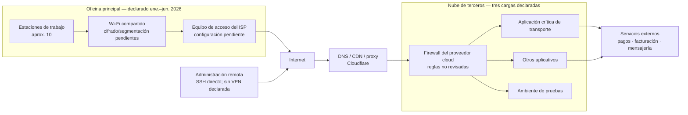

# Ciberseguridad — ETAPA 4: PR · Proteger plataformas

**Empresa:** AM Digital Web E.I.R.L.  
**Sistema crítico de referencia:** Bus Digital / instalación TopPeru  
**Controles:** PR-07 a PR-16 del Taller 03  
**Fecha de corte:** 20 de octubre de 2026  
**Clasificación:** CONFIDENCIAL  
**Tipo de revisión:** documental, configuración/código local y DNS público autorizado

## 1. Objetivo y límites

Esta etapa evalúa actualización y soporte de plataformas, antimalware/EDR, credenciales por defecto y hardening, cifrado de equipos y control de USB, seguridad física, segmentación, firewall, acceso remoto, Wi-Fi y seguridad del correo.

La revisión se limitó a documentación disponible, manifiestos del repositorio local y consultas DNS públicas autorizadas. No se ejecutaron escaneos de red o vulnerabilidades, auditorías de dependencias, conexiones a puertos, solicitudes HTTP a los dominios, intentos de autenticación, conexiones SSH/VPN, captura de tráfico, comandos en equipos de AM Digital, cambios de configuración ni inspección física.

Para PR-16 se consultaron únicamente registros públicos `MX`, `TXT` y `_dmarc` de los dominios atribuidos a AM Digital en el informe de prácticas. Para DKIM se consultó el selector documentado por Mailjet y un conjunto pequeño de selectores vinculados a los proveedores indicados por el propio DNS; no se realizó enumeración exhaustiva. No se reproducen claves DKIM ni direcciones IP.

### Escala de evaluación

| Resultado | Significado |
|---|---|
| ACREDITADA | Evidencia suficiente, vigente y trazable de la dimensión evaluada. |
| PARCIALMENTE ACREDITADA | Evidencia real, pero incompleta, histórica, informal o de cobertura limitada. |
| NO ACREDITADA | No se proporcionó evidencia suficiente. No prueba por sí sola que el control no exista. |
| NO EVALUABLE | No puede determinarse el funcionamiento con la evidencia disponible. |
| NO APLICA, POR CONFIRMAR | La condición que activaría el control no está acreditada; requiere confirmación del responsable. |

La **existencia formal** requiere política, estándar, procedimiento o diseño aprobado, con responsable y alcance. La **operación efectiva** exige cobertura, configuración vigente, seguimiento y evidencia fechada.

## 2. Fuentes revisadas y reservas

| Ref. | Fuente | Uso | Reserva |
|---|---|---|---|
| PL-01 | `ASTI - Taller 03 - Ciberseguridad.docx` | Criterios PR-07 a PR-16. | Guía académica; no es evidencia empresarial. |
| PL-02 | `Ciberseguridad_00_Preparacion.md` a `Ciberseguridad_03_Proteger_Accesos.md` | Alcance, fuentes, activos, exposición e identidades. | Documentos de trabajo; conservan las limitaciones de sus fuentes. |
| PL-03 | `Informe_Auditoria_BusDigital_EPIS_Actualizado.docx` | Antecedentes del Taller 02 sobre versiones, dependencias y configuración de aplicación. | Revisión estática; no acredita producción. |
| PL-04 | `Informe Final.pdf` de prácticas preprofesionales | Arquitectura observada entre enero y junio de 2026: oficina, Wi-Fi, Hetzner, Cloudflare, firewall y acceso SSH. | Informe académico e histórico; no es diagrama ni configuración aprobada al corte. |
| PL-05 | `reporte_simple_pentest_topperu.docx` | Antecedente de junio de 2026 sobre dependencias y hardening. | Borrador académico; no se repitieron pruebas ni se presume vigencia. |
| PL-06 | Repositorio local `/home/erivero96/Desktop/TopPeru` | Manifiestos y valores predeterminados de configuración. | El código no demuestra versión/configuración desplegada. `.env.example` es una plantilla, no el entorno productivo. |
| PL-07 | DNS público de `amdigital.pe`, `busdigital.com.pe` y `busdigital.pe` | MX, SPF, DKIM y DMARC consultados el 20/10/2026 a las 18:00 (UTC-5). | Fotografía puntual; DNS no demuestra que cada mensaje se firme, alinee o filtre correctamente. |
| PL-08 | Documentación oficial de Laravel, PHP, Microsoft, Mailjet y Brevo | Ciclos de soporte e interpretación de controles de correo. | Referencia externa, no evidencia de configuración de AM Digital. |

Referencias oficiales utilizadas:

- [Política de soporte de Laravel 10](https://laravel.com/framework/docs/10.x/releases).
- [Versiones soportadas de PHP](https://www.php.net/supported-versions.php) y [ramas PHP fuera de soporte](https://www.php.net/eol.php).
- [Fin de soporte de Windows 10](https://learn.microsoft.com/en-us/lifecycle/announcements/windows-10-end-of-support).
- [Configuración SPF/DKIM de Mailjet](https://documentation.mailjet.com/hc/en-us/articles/360049641733-Authenticating-Domains-with-SPF-and-DKIM-A-Complete-Guide).
- [Autenticación de dominios en Brevo](https://help.brevo.com/hc/en-us/articles/12163873383186-Authenticate-your-domain-with-Brevo-Brevo-code-DKIM-DMARC).

## 3. Matriz de los diez controles

| Control | Existencia formal | Operación efectiva | Evidencia disponible | Conclusión documental |
|---|---|---|---|---|
| PR-07 · Actualización y soporte | NO ACREDITADA | PARCIALMENTE ACREDITADA | `composer.lock` fija Laravel 10.48.28; manifiesto admite PHP `^8.1`; antecedente puntual de auditoría de dependencias. | No hay inventario productivo, política, calendario, SLA ni excepciones. Laravel 10 terminó soporte de seguridad el 04/02/2025. PHP productivo y SO de equipos/servidores son desconocidos. |
| PR-08 · Antimalware/EDR | NO ACREDITADA | NO ACREDITADA | PL-04 declaró que no había antivirus corporativo centralizado en las estaciones. | No se acredita consola, agente, cobertura, política, alertas ni protección de servidores. |
| PR-09 · Credenciales por defecto y hardening | NO ACREDITADA | NO EVALUABLE | Plantilla local conserva valores de desarrollo; pentest histórico reportó temas de hardening. | No se revisó producción. No hay baseline, checklist de entrega ni inventario de dispositivos/credenciales iniciales. |
| PR-10 · Cifrado de laptops y USB | NO ACREDITADA | NO ACREDITADA | No se encontró política, consola ni estado de BitLocker/FileVault/LUKS, USB o DLP. | Los equipos acceden a código y sistemas críticos, pero cifrado y medios removibles no están acreditados. |
| PR-11 · Seguridad física de rack/cuarto | NO ACREDITADA | NO EVALUABLE | PL-04 ubica producción en nube y solo identifica router/PCs en oficina. | No está acreditado que exista rack/cuarto local. Debe confirmarse y, si existe, revisar acceso, registro, UPS, extintor y temperatura mediante recorrido autorizado. |
| PR-12 · Segmentación/VLAN | NO ACREDITADA | NO ACREDITADA | PL-04 describe LAN simple, router del ISP y Wi-Fi compartido. | No hay VLAN, red de invitados, aislamiento de IoT ni diagrama aprobado demostrados. |
| PR-13 · Firewall | NO ACREDITADA | PARCIALMENTE ACREDITADA | PL-04 reporta firewall del proveedor Hetzner y Cloudflare frontal. | Se acredita una capa histórica básica, no propietario, reglas, cobertura, revisión, cambios, alertas ni protección de origen. |
| PR-14 · Acceso remoto | NO ACREDITADA | PARCIALMENTE ACREDITADA | PL-04 describe SSH directo a infraestructura cloud, con credenciales y/o llaves, sin VPN. | Existe control de autenticación básico declarado, pero no VPN/MFA, allowlist, bastión, inventario, caducidad o revisión de logs acreditados. RDP/AnyDesk/TeamViewer siguen sin confirmar. |
| PR-15 · Wi-Fi | NO ACREDITADA | NO ACREDITADA | PL-04 describe Wi-Fi compartido mediante router del ISP. | No se conoce WPA2/WPA3, separación de invitados, administración, rotación de clave ni baja de exintegrantes. |
| PR-16 · Correo y autenticación del dominio | NO ACREDITADA | PARCIALMENTE ACREDITADA | DNS público: SPF único, DKIM Mailjet y DMARC en los tres dominios; MX diferenciados. | Hay mecanismos técnicos, pero DMARC está en `p=none`; no se acredita filtro, alineación real, monitoreo, tratamiento de reportes ni cobertura de todos los remitentes. |

**Resultado:** ninguno de los diez controles acredita simultáneamente existencia formal y operación efectiva. PR-13, PR-14 y PR-16 tienen evidencia técnica parcial; PR-07 contiene un componente del repositorio inequívocamente fuera de soporte, aunque no se confirmó que sea la versión productiva.

## 4. Diagrama lógico de red sustentado por la evidencia

PL-04 proporciona evidencia suficiente para un esquema lógico **preliminar e histórico**, no para un diagrama físico o una topología vigente. Se omiten direcciones, dominios operativos y nombres internos de servidores.

### Lo que el diagrama permite afirmar

- La oficina utilizaba una LAN simple y Wi-Fi compartido para salir a Internet.
- La producción se alojaba en infraestructura cloud de Hetzner y era publicada mediante Cloudflare.
- Se declararon firewall del proveedor y administración SSH directa sin VPN.
- Se distinguieron cargas productivas, otros proyectos y pruebas a nivel lógico.

### Lo que el diagrama no acredita

- VLAN, subredes, listas de control, red de invitados, IoT, doble ISP o alta disponibilidad.
- Reglas del firewall, puertos, ruta de administración, bypass de Cloudflare o aislamiento entre cargas.
- Topología actual, propiedad de cada componente, versiones, cifrado Wi-Fi o inventario completo.
- Ubicación de BD, backups, paneles administrativos o controles de cliente.

## 5. Evaluación detallada

### PR-07 · Actualización controlada y plataformas soportadas

**Existencia formal:** **NO ACREDITADA.**  
No se proporcionó política de parches, inventario de versiones productivas, responsables, ventanas de mantenimiento, SLA por severidad, pruebas previas, rollback, excepciones ni indicador de cumplimiento.

**Operación efectiva:** **PARCIALMENTE ACREDITADA.**  
El repositorio permite observar un `composer.lock` con Laravel 10.48.28. La política oficial de Laravel señala que la rama 10 dejó de recibir correcciones de seguridad el 4 de febrero de 2025. El manifiesto admite PHP desde 8.1, pero esto no revela la versión instalada; PHP 8.1 terminó soporte el 31 de diciembre de 2025. Por ello, la aplicación requiere una ruta de actualización, pero no se puede afirmar que producción ejecute PHP 8.1 ni que el repositorio local coincida con el despliegue.

No hay versiones de Windows/Linux, firmware, navegador, router, Cloudflare, BD o demás aplicaciones instaladas. Si alguna estación continúa en Windows 10 sin ESU o una edición con ciclo distinto, su soporte general terminó el 14 de octubre de 2025; primero debe verificarse el inventario real.

**Evidencia:** PL-03, PL-05, PL-06 y PL-08.

**Brecha:** gestión reactiva y por componentes, sin vista completa de fin de vida ni prueba de que parches críticos se instalan dentro de plazos definidos. El análisis histórico de dependencias no reemplaza un proceso periódico.

**Validación pendiente:** inventario producto-versión-activo; reporte de parches; ciclo EOL; tickets recientes; excepciones y plan probado de migración de Laravel/PHP.

### PR-08 · Antimalware o EDR

**Existencia formal:** **NO ACREDITADA.**  
No se encontró estándar de protección de endpoints/servidores, responsable, cobertura objetivo, exclusiones, retención de alertas o proceso de respuesta.

**Operación efectiva:** **NO ACREDITADA.**  
PL-04 declaró ausencia de antivirus corporativo centralizado en las estaciones durante el periodo observado. No se sabe si cada sistema tenía protección nativa, si se administraba, estaba actualizado o enviaba alertas. Tampoco existe evidencia para servidores Linux, equipos personales o dispositivos de terceros.

**Evidencia:** PL-04 y ausencia de consola/reportes en el inventario documental.

**Brecha:** aproximadamente diez estaciones con acceso a código, credenciales, nube y servidores no tienen cobertura central demostrada. No se conoce si hay equipos sin agente, protecciones deshabilitadas o alertas sin atender.

**Validación pendiente:** consola administrada por TI, cobertura por activo/SO, política aplicada, estado de firmas/sensor, tamper protection, exclusiones y una alerta anonimizada con cierre.

### PR-09 · Credenciales predeterminadas y hardening

**Existencia formal:** **NO ACREDITADA.**  
No se encontraron baselines para estaciones, Linux, router, Wi-Fi, impresoras, cámaras, UPS, nube, BD, Laravel o contenedores, ni checklist que obligue a cambiar credenciales iniciales.

**Operación efectiva:** **NO EVALUABLE.**  
La plantilla `.env.example` usa parámetros explícitos de desarrollo, como debug y cookie no segura, además de valores de ejemplo. Es correcto tratarlos como plantilla local; no demuestran producción. PL-05 reportó históricamente modo debug, rutas de prueba y otros temas de hardening, pero no se revalidaron.

**Evidencia:** PL-05 y PL-06 (`.env.example`, configuración de sesión, CORS y Telescope), únicamente como indicios de revisión.

**Brecha:** no hay garantía documentada de eliminación de cuentas/contraseñas por defecto, cierre de servicios, configuración segura, separación de ambientes ni revisión posterior a cambios. No debe solicitarse a TI que revele contraseñas: basta evidencia del cambio y estado.

**Validación pendiente:** baseline CIS/equivalente adaptado, checklist por tipo de activo, comparación de cumplimiento, gestión de excepciones y pantalla sanitizada de producción con debug/diagnóstico/cookies/CORS.

### PR-10 · Cifrado de laptops, USB y prevención de fuga

**Existencia formal:** **NO ACREDITADA.**  
No se proporcionó política de cifrado, BYOD, medios removibles, DLP, copias locales, custodia de claves ni borrado seguro.

**Operación efectiva:** **NO ACREDITADA.**  
No se conoce si las estaciones usan BitLocker, FileVault, LUKS u otra protección, ni si las claves de recuperación están bajo custodia empresarial. Tampoco se acredita bloqueo/registro de USB, cifrado de medios permitidos o restricción de copias a dispositivos personales.

**Evidencia:** PL-04 confirma el uso de estaciones para desarrollo y administración; no aporta controles de cifrado/USB. El cifrado de un equipo particular del investigador descrito en el Taller 02 no es evidencia corporativa.

**Brecha:** pérdida o robo de un equipo podría exponer código, copias, sesiones y credenciales. El control debe abarcar propiedad empresarial y BYOD autorizado.

**Validación pendiente:** reporte de cifrado por equipo, escrow de claves, política de USB, consola MDM/endpoint, excepciones, DLP si existe y procedimiento de baja/borrado.

### PR-11 · Seguridad física del rack o cuarto técnico

**Existencia formal:** **NO ACREDITADA.**  
No se encontró política o responsable de seguridad física, registro de acceso, mantenimiento de UPS, revisión de extintores o monitoreo ambiental.

**Operación efectiva:** **NO EVALUABLE.**  
PL-04 sitúa los servidores productivos en nube y describe en la oficina estaciones, Wi-Fi y equipo del ISP. No confirma la existencia de rack o cuarto de servidores local. Si no existe, los requisitos de rack deben marcarse no aplicables con justificación; aun así, deben protegerse el router, equipos, respaldos locales y soportes físicos.

**Evidencia:** PL-04. No se realizó recorrido ni se usaron fotografías.

**Brecha:** condición de aplicabilidad y controles físicos básicos no verificados.

**Validación pendiente:** confirmación escrita de instalaciones; recorrido acompañado autorizado; control de acceso, registro, cerradura, UPS, extintor apropiado, temperatura/humedad, cableado y ubicación del equipo de red. Fotografías solo con autorización expresa.

### PR-12 · Segmentación por VLAN

**Existencia formal:** **NO ACREDITADA.**  
No existe diagrama aprobado, estándar de zonas, matriz de flujos ni propietario de red.

**Operación efectiva:** **NO ACREDITADA.**  
La arquitectura histórica describe una LAN simple, Wi-Fi compartido y router del ISP. No aporta evidencia de VLAN o separación entre personal, invitados, IoT, cámaras, administración o laboratorios. Tampoco se acredita aislamiento entre cargas cloud.

**Evidencia:** PL-04 y diagrama lógico de este informe.

**Brecha:** una red plana permitiría compartir el mismo dominio de exposición a dispositivos de distinta confianza. Esto debe confirmarse mediante la configuración mostrada por TI, no mediante escaneo.

**Validación pendiente:** diagrama sin IP, lista de VLAN/zonas con propósito, matriz origen-destino-servicio, SSID asociados y reglas entre segmentos.

### PR-13 · Firewall perimetral

**Existencia formal:** **NO ACREDITADA.**  
No se entregó política de firewall, responsables, estándar de reglas, periodicidad de revisión, aprobación de cambios, caducidad de excepciones ni registro de última recertificación.

**Operación efectiva:** **PARCIALMENTE ACREDITADA.**  
PL-04 declaró firewall de Hetzner activo y Cloudflare como capa frontal. Esto constituye evidencia histórica de capas perimetrales, pero no muestra reglas, cobertura, logging, alertas ni si el origen puede alcanzarse evitando el proxy.

**Evidencia:** PL-04. No se verificaron puertos, servicios o rutas.

**Brecha:** no se puede decidir si se aplica denegación por defecto, mínimo acceso administrativo, restricción de origen, egress filtering o revisión de reglas obsoletas.

**Validación pendiente:** vista sanitizada de reglas cloud y del equipo de oficina, fecha/autor de última revisión, tickets de cambio, reglas temporales, logs/alertas y evidencia de protección del origen.

### PR-14 · Acceso remoto

**Existencia formal:** **NO ACREDITADA.**  
No se encontró política, inventario de herramientas, matriz de usuarios, aprobación, MFA, requisitos del dispositivo, horario, registro o revisión.

**Operación efectiva:** **PARCIALMENTE ACREDITADA.**  
PL-04 describe SSH directo desde Internet a servidores cloud con credenciales y/o llaves, restringido al equipo de desarrollo, y ausencia de VPN. No se acreditan llaves individuales, deshabilitación de contraseña/root, allowlist, bastión, MFA, logs ni revocación. Se desconoce si RDP, AnyDesk, TeamViewer u otras herramientas están instaladas o expuestas.

**Evidencia:** PL-04 y la matriz de accesos de ETAPA 3. No se intentó conexión.

**Brecha:** el acceso administrativo depende de controles no demostrados y amplía la superficie directa. La expresión “restringido al equipo” es declarativa y requiere evidencia de cuentas/llaves nominales.

**Validación pendiente:** configuración ejecutada/mostrada por TI de VPN o Zero Trust, SSH, usuarios/llaves, MFA, allowlist, logs, herramientas remotas autorizadas y baja reciente.

### PR-15 · Seguridad Wi-Fi

**Existencia formal:** **NO ACREDITADA.**  
No se proporcionó estándar inalámbrico, propietario, calendario de rotación, proceso de alta/baja ni diseño de invitados.

**Operación efectiva:** **NO ACREDITADA.**  
Solo se conoce que existía Wi-Fi compartido sobre un router del ISP. No se determinó cifrado WPA2/WPA3, WPS, administración remota, firmware, contraseña de gestión, SSID de invitados, aislamiento cliente-cliente o conocimiento de la clave por exempleados.

**Evidencia:** PL-04. No hubo observación, captura inalámbrica ni conexión.

**Brecha:** secreto compartido sin trazabilidad y posible mezcla de equipos empresariales, personales e invitados.

**Validación pendiente:** pantalla sanitizada del controlador/router, modo WPA, WPS, redes/segmentos, aislamiento, firmware, administradores, fecha de rotación y procedimiento de baja.

### PR-16 · Seguridad del correo, SPF, DKIM y DMARC

**Existencia formal:** **NO ACREDITADA.**  
No se encontró política de correo, dominio autorizado por tipo de mensaje, responsable DNS, estándar SPF/DKIM/DMARC, filtro antiphishing, proceso de cuarentena o revisión de reportes.

**Operación efectiva:** **PARCIALMENTE ACREDITADA.**  
La fotografía DNS pública autorizada muestra lo siguiente:

| Dominio atribuido | MX observado | SPF | DKIM Mailjet | DMARC | Evaluación |
|---|---|---|---|---|---|
| `amdigital.pe` | Tres MX de un servicio externo de protección de correo. | Un registro; autoriza Mailjet, el servicio de correo/protección, Zoho y mecanismos de host; termina en `~all`. | Presente; clave que aparenta 1024 bits. | Presente, `p=none`, con dirección agregada de Brevo. | Autenticación parcial y filtrado probable por MX; política DMARC solo monitorea. Debe depurarse el conjunto amplio de remitentes autorizados y confirmar alineación. |
| `busdigital.com.pe` | MX dirigido al propio dominio. | Un registro; autoriza Mailjet, MX/host y una dirección explícita; termina en `~all`. | Presente; clave que aparenta 2048 bits. | Presente, `p=none`, con dirección agregada de Brevo. | Base técnica presente; no se acredita filtro de entrada. DMARC no solicita cuarentena/rechazo. |
| `busdigital.pe` | MX dirigido al propio dominio. | Un registro; autoriza Mailjet, MX/host y una dirección explícita; termina en `~all`. | Presente; clave que aparenta 1024 bits. | Presente, `p=none`, con dirección agregada de Brevo. | Igual reserva: autenticación parcial, filtrado no demostrado y DMARC sin enforcement. |

#### Interpretación y límites de DNS

- Cada dominio publicó un único registro SPF visible, lo que evita el error básico de múltiples SPF separados. `~all` aplica softfail, no rechazo estricto.
- Los tres publicaron `mailjet._domainkey`, selector indicado por la documentación oficial de Mailjet. No se reproducen las claves.
- La longitud aparente se infiere del material público de clave: 1024 bits en dos dominios y 2048 bits en `busdigital.com.pe`. Mailjet documenta 2048 bits como valor predeterminado más fuerte; la rotación debe coordinarse con el proveedor.
- Los tres dominios tienen DMARC con `p=none`: reciben reportes agregados, pero la política publicada no pide a los receptores poner en cuarentena o rechazar mensajes que fallen.
- No se publicaron parámetros explícitos `adkim`, `aspf` o `sp`; aplican los valores predeterminados del estándar. Esto no demuestra fallo, pero sí ausencia de una política más estricta declarada.
- La existencia de códigos de verificación de Brevo no prueba que Brevo DKIM esté activo. Sus selectores pueden variar o usar CNAME; TI debe mostrar el estado del dominio en la consola.
- DNS no permite concluir que todos los flujos reales pasan SPF/DKIM/DMARC. Para ello, TI debe mostrar encabezados de mensajes legítimos enviados internamente y reportes agregados, sin datos personales.
- No se evaluaron MTA-STS, TLS-RPT o BIMI porque están fuera de PR-16 y no fueron solicitados.

**Evidencia:** PL-07; PL-08; PL-06 muestra uso de Mailjet en procesos de aplicación y una plantilla SMTP no productiva.

**Brecha:** DMARC sin enforcement, cobertura/alineación no demostrada, dos claves Mailjet aparentemente de 1024 bits, inventario de remitentes incompleto y filtros antispam/antiphishing no acreditados.

**Validación pendiente:** proveedor y dominios emisores reales; estado SPF/DKIM en Mailjet/Brevo/Zoho; muestras de `spf=pass`, `dkim=pass` y `dmarc=pass`; tratamiento de reportes; filtro, cuarentena, impersonation protection y plan gradual hacia `quarantine`/`reject` después de depurar remitentes.

## 6. Capturas y configuraciones que TI debe mostrar

TI debe operar las consolas en modo de solo lectura. Las capturas solo deben conservarse con autorización expresa y deben ocultar IP, dominios internos, usuarios, correos personales, tokens, claves, reglas sensibles y datos de clientes. Nunca se deben mostrar contraseñas ni claves privadas.

| Prioridad | Control | Pantalla/configuración a mostrar | Campos mínimos visibles | Sanitización / condición |
|---|---|---|---|---|
| P1 | PR-07 | Inventario de SO, firmware, runtimes, framework, BD y aplicaciones. | Producto, versión, activo, entorno, soporte/EOL, dueño y última actualización. | Identificadores internos seudonimizados. |
| P1 | PR-07 | Consola o reporte de parches y tickets de dos actualizaciones recientes. | Cobertura, fecha, estado, fallos, aprobación y rollback. | Sin nombres personales ni IP. |
| P1 | PR-07 | Versión productiva de Laravel/PHP y plan de actualización. | Versión efectiva, ambiente, responsable, pruebas y fecha objetivo. | TI ejecuta el comando o abre la consola; auditor solo observa. |
| P1 | PR-08 | Consola EDR/antimalware. | Total de activos, protegidos, sin agente, desactualizados, políticas y última comunicación. | Ocultar hostnames; mostrar totales y estados. |
| P1 | PR-08 | Una alerta cerrada y una excepción. | Fecha, severidad, acción, responsable y cierre. | Caso anonimizado y sin archivo malicioso descargable. |
| P1 | PR-10 | Estado de cifrado de todas las laptops. | Equipo seudónimo, tecnología, estado, custodia de recuperación y excepción. | Nunca mostrar claves de recuperación. |
| P1 | PR-13 | Reglas de firewall cloud y de oficina. | Zona/origen lógico, destino lógico, servicio, acción, dueño, fecha y caducidad. | Sin IP ni reglas que revelen superficie sensible. |
| P1 | PR-13 | Última revisión de reglas y cambios recientes. | Fecha, aprobador, reglas retiradas, excepciones y evidencia de cierre. | Exportación sanitizada. |
| P1 | PR-14 | Configuración de acceso remoto/SSH/VPN/Zero Trust. | MFA, usuarios nominales, llaves, allowlist, tiempo de sesión y logging. | No mostrar claves, huellas completas, IP o tokens. |
| P1 | PR-16 | Consolas de correo/Mailjet/Brevo/Zoho y DNS. | Dominios autenticados, SPF/DKIM/DMARC, remitentes, fallos y última revisión. | Ocultar códigos de recuperación/API y PII. |
| P1 | PR-16 | Encabezados de mensajes legítimos de prueba generados por TI. | `spf`, `dkim`, `dmarc`, dominios de alineación y fecha. | Eliminar destinatario, Message-ID, IP y contenido. |
| P2 | PR-09 | Baseline/checklist de router, Linux, endpoints, aplicación, BD e IoT. | Parámetro, valor esperado, estado, excepción y revisor. | No mostrar secretos o configuración explotable. |
| P2 | PR-09 | Configuración productiva de aplicación sanitizada. | Debug, cookies seguras, CORS, Telescope/diagnóstico y ambiente. | Solo valores no secretos; sin `.env` completo. |
| P2 | PR-10 | Política de USB/MDM/DLP. | Bloqueo, excepciones, registro, cifrado y aprobación. | Mostrar cumplimiento agregado. |
| P2 | PR-11 | Evidencia física, solo si existe rack/cuarto. | Acceso, cerradura, registro, UPS, extintor, temperatura y cableado. | Recorrido/fotos con autorización; sin personas/pantallas. |
| P2 | PR-12 | Diagrama vigente y configuración de VLAN/zonas. | Usuarios, invitados, administración, servidores e IoT; flujos permitidos. | Sin IP, SSID sensible ni nombres internos. |
| P2 | PR-15 | Router/controlador Wi-Fi. | WPA2/WPA3, WPS, invitados, aislamiento, firmware y última rotación. | No mostrar SSID real, PSK ni dirección de administración. |
| P3 | PR-16 | Reportes DMARC agregados y cuarentena. | Volumen, alineación, fuentes autorizadas/no autorizadas y tendencia. | Datos agregados; no direcciones individuales. |

## 7. Evidencias y acciones priorizadas

1. **Confirmar versiones productivas y EOL.** Entregar inventario de SO/aplicaciones y un plan fechado para Laravel 10; verificar PHP sin inferirlo del manifiesto.
2. **Acreditar protección de endpoints.** Mostrar cobertura real de antimalware/EDR y cifrado de discos, incluyendo equipos personales autorizados.
3. **Reducir la exposición administrativa.** Documentar SSH y migrar a VPN/Zero Trust/bastión con MFA, cuentas/llaves nominales, registro y revocación.
4. **Recertificar el perímetro.** Mostrar reglas de firewall, protección del origen, revisión reciente y excepciones temporales.
5. **Separar redes por confianza.** Confirmar si la LAN es plana; diseñar usuarios, invitados, administración e IoT con flujos mínimos.
6. **Formalizar Wi-Fi.** WPA2/WPA3, WPS deshabilitado, red de invitados aislada y rotación vinculada a bajas.
7. **Endurecer el correo de forma gradual.** Inventariar remitentes, comprobar alineación, analizar reportes DMARC y avanzar de `p=none` a `quarantine`/`reject` solo después de pruebas controladas.
8. **Rotar/elevar DKIM cuando corresponda.** Confirmar la longitud en el proveedor y priorizar 2048 bits para los dos registros Mailjet que aparentan 1024 bits, sin interrumpir envíos.
9. **Definir baselines.** Incluir cambio de credenciales por defecto, debug/diagnóstico, cookies, CORS, servicios, cuentas y firmware.
10. **Resolver aplicabilidad física.** Confirmar si existe rack/cuarto; si no, documentar la no aplicabilidad y proteger router, endpoints y soportes de oficina.

## 8. Conclusión de la ETAPA 4

La arquitectura disponible muestra controles técnicos básicos —Cloudflare, firewall del proveedor, autenticación SSH y mecanismos DNS de correo—, pero no un programa formal y verificable de protección de plataformas. La mayor exposición documental combina un framework fuera de soporte, ausencia histórica de protección centralizada de endpoints, acceso SSH directo sin VPN, Wi-Fi compartido y falta de evidencia sobre cifrado, segmentación, hardening y revisión de reglas.

PR-16 alcanza cobertura parcial: SPF, DKIM Mailjet y DMARC están publicados en los tres dominios revisados. Sin embargo, DMARC permanece en monitoreo (`p=none`), dos claves DKIM aparentan 1024 bits y no se acreditó la alineación de mensajes reales ni la operación de filtros antiphishing.

El diagrama de red incluido es lógico, sanitizado e histórico; debe ser validado por TI antes de tratarlo como arquitectura vigente. Esta etapa se detiene en PR-16 y no inicia PR-17 ni controles posteriores.
