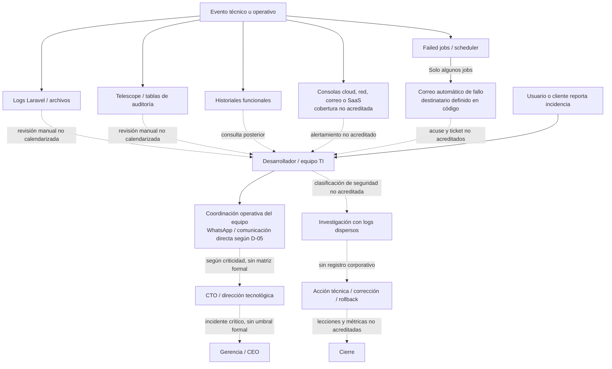

# Ciberseguridad — ETAPA 5: DE · Detectar

**Empresa:** AM Digital Web E.I.R.L.  
**Sistema crítico de referencia:** Bus Digital / instalación TopPeru  
**Controles:** DE-01 a DE-05 del Taller 03  
**Fecha de corte:** 20 de octubre de 2026  
**Clasificación:** CONFIDENCIAL  
**Tipo de revisión:** documental y de código/configuración local; sin lectura de registros con datos

## 1. Objetivo y límites

Esta etapa evalúa la generación, centralización y retención de logs; la existencia y cobertura de SIEM/SOC; la recepción y tratamiento de alertas; las reglas para accesos anómalos; y el tiempo de detección de incidentes históricos.

Se reutilizaron los antecedentes del Taller 02 sobre Laravel Auditing, Telescope, logs de API, logs diarios e historiales de negocio. Esos antecedentes se mantienen como evidencia estática o de laboratorio y no se presentan como controles productivos aprobados.

No se abrieron archivos de `storage/logs`, tablas `audits`, `api_logs`, `telescope_entries`, historiales, `failed_jobs`, registros de base de datos, consolas de proveedor ni volcados. Tampoco se revisaron payloads, cabeceras, datos personales, tokens, secretos o registros productivos. No se realizaron conexiones, consultas SQL, pruebas de generación de eventos ni cambios de configuración.

### Distinción esencial

| Concepto | Criterio utilizado |
|---|---|
| Registrar | Un sistema conserva un evento, error, solicitud o cambio para consulta posterior. |
| Monitorear | Una persona o herramienta revisa fuentes con una frecuencia y cobertura definidas. |
| Alertar | Una condición genera una notificación dirigida, priorizada y trazable. |
| Detectar un incidente | Eventos relacionados se interpretan como una amenaza o incidente y activan respuesta dentro de un tiempo medible. |

La presencia de logs no acredita monitoreo; Telescope no es por sí mismo un SIEM; un correo por fallo de un job no es necesariamente una alerta de seguridad; y un rate limit que bloquea intentos no acredita que alguien detecte o investigue el patrón.

### Escala de evaluación

| Resultado | Significado |
|---|---|
| ACREDITADA | Evidencia suficiente, vigente y trazable de la dimensión. |
| PARCIALMENTE ACREDITADA | Evidencia real, pero incompleta, histórica, informal o de cobertura limitada. |
| NO ACREDITADA | No se proporcionó evidencia suficiente. No prueba por sí sola que el control no exista. |
| NO EVALUABLE | No es posible determinar el funcionamiento o medirlo con la evidencia disponible. |

## 2. Fuentes revisadas y reservas

| Ref. | Fuente | Uso | Reserva |
|---|---|---|---|
| D-01 | `ASTI - Taller 03 - Ciberseguridad.docx` | Criterios DE-01 a DE-05. | Guía académica; no es evidencia de AM Digital. |
| D-02 | `Ciberseguridad_00_Preparacion.md` a `Ciberseguridad_04_Proteger_Plataformas.md` | Alcance, activos, identidades, plataformas y solicitudes pendientes. | Documentos de trabajo. |
| D-03 | `Informe_Auditoria_BusDigital_EPIS_Actualizado.docx` | Cobertura estática de logging, auditoría, colas y ausencia de centralización acreditada. | Taller 02; no se conectó a producción. |
| D-04 | `Informe_Seguridad_Informatica_Bus_Digital.docx` / `INFORME PISTAS DE AUDITORIA.pdf` | Ejemplo de trazabilidad en instancia local con MariaDB, Laravel, Telescope e historiales. | Laboratorio local; no representa producción. No se reabrieron sus registros en esta etapa. |
| D-05 | `Informe Final.pdf` de prácticas preprofesionales | Organización de TI, monitoreo básico, atención reactiva de incidencias y comunicación por WhatsApp. | Informe académico e histórico; no es procedimiento aprobado. |
| D-06 | Repositorio local `/home/erivero96/Desktop/TopPeru` | Configuración de logs, auditoría, Telescope, middleware, jobs, rutas e historiales. | Código estático; no demuestra despliegue, datos, retención ni operación productiva. |

## 3. Matriz de evaluación DE-01 a DE-05

| Control | Existencia formal | Operación efectiva | Evidencia | Conclusión documental |
|---|---|---|---|---|
| DE-01 · Generación, centralización y retención | NO ACREDITADA | PARCIALMENTE ACREDITADA | Configuración Laravel, Telescope, Auditing, API logs, historiales y prueba local D-04. | Hay múltiples fuentes capaces de registrar eventos, pero no inventario aprobado, centralización, sincronización horaria, integridad, revisión ni retención homogénea. |
| DE-02 · SIEM/SOC | NO ACREDITADA | NO ACREDITADA | No se encontró contrato, arquitectura, consola, turnos, SLA o reportes. | Telescope y visores locales no constituyen SIEM/SOC. Los canales opcionales de Slack/Papertrail en configuración no demuestran activación. |
| DE-03 · Gestión de alertas | NO ACREDITADA | PARCIALMENTE ACREDITADA, SOLO OPERACIONAL | Algunos jobs envían correo al fallar; existen errores en logs y monitoreo operativo básico descrito en D-05. | No hay matriz de alertas de seguridad, guardia, severidades, acuse, escalamiento, SLA ni muestra sanitizada de alerta atendida. |
| DE-04 · Accesos anómalos | NO ACREDITADA | NO ACREDITADA | Fortify limita intentos; Telescope puede registrar solicitudes; Cargo tiene autenticación propia. | No se hallaron reglas/alertas para fallos repetidos, geografía, horario, impossible travel, alta de privilegios o cuentas administrativas. Rate limiting es prevención, no detección demostrada. |
| DE-05 · Tiempo de detección histórico | NO ACREDITADA | NO EVALUABLE | No se entregó registro corporativo de incidentes con marcas de tiempo. | No pueden calcularse MTTD, máximo, mediana ni método de detección. Las incidencias operativas no deben clasificarse retroactivamente como incidentes de seguridad. |

**Resultado:** ninguno de los cinco controles acredita simultáneamente existencia formal y operación efectiva. AM Digital/Bus Digital tiene capacidad de trazabilidad técnica, pero no se acredita un proceso de detección de seguridad extremo a extremo.

## 4. Matriz de fuentes de logs

| Fuente candidata | Eventos declarados | Ubicación / mecanismo | Cobertura observada en código o antecedentes | Retención declarada | Alerta o detección | Estado y brecha |
|---|---|---|---|---|---|---|
| Laravel, canal predeterminado | Mensajes `debug` a `critical`, según llamadas de la aplicación. | Archivo local mediante Monolog. | Amplia pero dependiente de mensajes escritos por cada módulo; D-04 mostró que una venta no quedó registrada de forma completa en `laravel.log`. | Canal `daily`: 14 días si es el activo. `.env.example` selecciona `stack`/`single`; producción desconocida. | No hay regla automática acreditada. | Fuente útil, no centralizada. Canal y nivel productivos pendientes. |
| Canales Laravel especializados | SUNAT, pruebas, web, websockets, postergaciones, cron, anulaciones. | Archivos locales separados con driver `single`. | Selectiva por módulo; múltiples llamadas de error/información. | Sin rotación propia declarada en esos canales; depende de controles externos no acreditados. | No se halló correlación central. | Riesgo de crecimiento, dispersión y revisión manual. |
| Laravel Telescope | Solicitudes, excepciones, jobs, logs de error, correo, consultas, eventos, modelos, gates y tareas programadas. | Tablas `telescope_*` en BD por defecto. | El filtro revisado retorna `true` para toda entrada; watchers amplios. D-04 demostró trazabilidad solo en laboratorio. | No se halló `telescope:prune` programado. | Consola de diagnóstico; no se observaron reglas de alerta/correlación. | Alta telemetría potencial, con riesgo de volumen y datos sensibles. No es SIEM. |
| Laravel Auditing | Creación, actualización, eliminación y restauración; usuario, IP, agente, URL, valores anteriores/nuevos. | Tabla `audits` en BD. | Configuración global disponible; uso confirmado al menos en `CajaMovimientos`. `Viajes` importa el paquete pero usa un historial propio. | `threshold=0` equivale a sin límite por modelo; no se halló limpieza programada. | No genera alerta de seguridad por sí mismo. | Cobertura por modelo heterogénea y sin retención formal. |
| Historial de viajes | Estado, fecha/hora, precios, tripulación y otros cambios funcionales. | Tabla/modelo `viaje_auditorias` y traits propios. | Cobertura específica de procesos de viaje. | No declarada. | Consulta posterior; no regla de detección. | Evidencia funcional, no monitor de seguridad. |
| Historial de asientos | Bloqueo, venta, liberación, transferencia y acciones relacionadas. | `asientos_historiales`. | D-04 relacionó una venta con usuario en laboratorio. | No declarada. | Sin alerta. | Útil para fraude/integridad si se correlaciona; hoy no está acreditado. |
| Historiales de negocio adicionales | Estados de encomiendas, postergaciones, SUNAT, comisiones, pagos/caja y reasignaciones. | Tablas y modelos funcionales separados. | Cobertura por módulo, no uniforme. | No declarada. | Principalmente consulta/auditoría posterior. | Fuentes valiosas, sin catálogo, propietario o correlación. |
| `activity_logs` | Cambios de modelos observados con valores anteriores/nuevos. | Tabla propia. | Observer localizado para países; una ruta de prueba devuelve actividad. No se demostró cobertura general. | No declarada. | Sin alerta. | Cobertura estrecha; la ruta de prueba requiere revisión de exposición. |
| `api_logs` / middleware `log.api` | Usuario, método, URL, IP, cabeceras, cuerpo de solicitud, estado y cuerpo de respuesta. | Tabla `api_logs`. | El alias existe, pero en las rutas revisadas solo se aplica a un endpoint de prueba con autenticación básica; no cubre todas las APIs. | No declarada; no se halló poda. | No genera alerta. | Cobertura mínima y captura excesiva potencial. Debe minimizar secretos/PII antes de ampliar. |
| Visor web de archivos | Lista y contenido de archivos `.log`. | Rutas `/logs` y vista por archivo. | Requiere autenticación, sesión verificada; no se observó permiso administrativo específico. | Hereda la retención de archivos. | Revisión manual. | Acceso demasiado amplio potencial según cadena estática; confirmar middleware adicional/despliegue. |
| Trabajos fallidos | Cola, payload, excepción y fecha de fallo. | Tabla `failed_jobs`; comando diagnóstico disponible. | Infraestructura presente. El comando de verificación no está programado en el scheduler revisado. | No declarada. | Algunos jobs ejecutan callback `failed()` y envían correo. | Detección operacional selectiva, no seguridad ni cobertura de todas las colas. |
| Fallos de jobs de encomiendas | Excepción y detalles operativos del proceso. | Correo mediante Mailjet a destinatario configurado en código. | Presente en algunos jobs de guías/actualización. | Retención del correo desconocida. | Notificación automática operacional. | No hay severidad, guardia, acuse ni ticket acreditados; el contenido podría incluir datos operativos. |
| Scheduler/SUNAT | Ejecuciones y errores de procesos programados; reintento/consulta de errores SUNAT. | Scheduler, logs y jobs diarios. | Dos jobs de revisión SUNAT declarados; otros schedulers están comentados. | Según log/BD, no formalizada. | Monitoreo operacional de facturación. | No equivale a detección de amenazas. |
| MariaDB General Query Log | Consultas, conexión y límites transaccionales. | Registro nativo del motor. | Solo D-04, instancia local: estaba desactivado al cierre y se usaron filas históricas. Binary Log desactivado; sin plugin de auditoría. | No acreditada. | No alerta. | No trasladable a producción; alto volumen y sensibilidad. |
| Cloudflare / firewall Hetzner | Tráfico, bloqueos y eventos perimetrales potenciales. | Consolas del proveedor. | Existencia de las capas descrita, no logging/plan/cobertura. | No acreditada. | Alertas no acreditadas. | Fuente crítica pendiente de acceso de solo lectura y exportación. |
| SSH / SO de servidores | Autenticación, `sudo`, procesos y sistema. | Logs del sistema cloud. | Acceso SSH directo conocido; fuentes y centralización no documentadas. | No acreditada. | Reglas no acreditadas. | Vacío crítico para accesos privilegiados y persistencia. |
| Endpoints/EDR | Malware, comportamiento, aislamiento y estado del agente. | Consola EDR/antimalware. | ETAPA 4 no acreditó EDR centralizado. | No aplica hasta confirmar herramienta. | No acreditada. | Falta una fuente clave de detección. |
| Correo/DMARC | Spam, phishing, autenticación y reportes agregados. | Proveedores de correo/Brevo; DNS declara `rua`. | SPF/DKIM/DMARC parciales; no se mostraron reportes o consola. | No acreditada. | No se conoce destinatario operativo ni revisión. | Publicar DMARC no demuestra consumir o atender sus reportes. |
| GitHub/SaaS críticos | Login, membresía, cambios, tokens y acciones administrativas. | Logs de auditoría del proveedor, según plan. | Plataformas conocidas; logs, plan y retención no acreditados. | No acreditada. | No acreditada. | Fuentes ausentes del flujo de detección documentado. |

### Riesgos de contenido y acceso

- `LogApiRequests` declara captura de cabeceras, cuerpo completo de solicitud, respuesta completa y objeto de usuario. No se observa minimización en ese middleware. Antes de ampliar su uso deben excluirse `Authorization`, cookies, tokens, credenciales y PII.
- Telescope oculta `_token` y tres cabeceras en entornos no locales, pero el filtro almacena todas las entradas y no se observa ocultamiento explícito de todos los secretos posibles.
- Los canales especializados usan archivos `single`; sin rotación externa acreditada pueden crecer indefinidamente.
- Auditing, Telescope, API logs, trabajos fallidos e historiales no tienen limpieza programada visible. Retención ilimitada no equivale a buena conservación: aumenta exposición, costo y riesgo de indisponibilidad.
- El visor `/logs` declara autenticación general, pero no un permiso administrativo específico. El acceso real debe comprobarse sin abrir contenido sensible.

## 5. Evaluación detallada por control

### DE-01 · Fuentes, centralización y retención

**Existencia formal:** **NO ACREDITADA.**  
No se entregó inventario corporativo de fuentes, política de logging, clasificación de eventos, propietarios, normalización, zona horaria, integridad, acceso, retención, eliminación o capacidad de almacenamiento.

**Operación efectiva:** **PARCIALMENTE ACREDITADA.**  
El código contiene diversas fuentes y D-04 probó que varias pueden complementarse en una instancia local. La cobertura es heterogénea: el log de aplicación depende de mensajes manuales; Auditing solo opera en modelos que implementan el contrato/trait; los historiales son funcionales; `log.api` cubre una ruta de prueba revisada; y Telescope instrumenta ampliamente, pero no acredita revisión.

No se observó exportación a un repositorio central. Laravel define 14 días solo para el canal `daily`; producción podría usar otro canal. Los archivos especializados, tablas e historiales carecen de retención visible. No se halló poda programada de Telescope.

**Evidencia:** D-03, D-04 y D-06: `config/logging.php`, `config/audit.php`, `config/telescope.php`, `TelescopeServiceProvider.php`, middleware/modelos/migraciones e historiales.

**Brecha:** eventos relevantes permanecen dispersos en archivos y tablas del mismo sistema que se investiga, con acceso, integridad, capacidad y conservación no demostrados. No existe una línea base de qué debe registrarse y qué debe excluirse.

**Preguntas:**

1. ¿Qué fuentes productivas están activas y quién es dueño de cada una?
2. ¿Qué canal/nivel Laravel usa producción y qué proceso rota los archivos `single`?
3. ¿Dónde se centralizan logs de aplicación, SO, SSH, firewall, Cloudflare, BD, correo, endpoints, GitHub y SaaS?
4. ¿Qué retención se exige por fuente y riesgo, y quién autoriza eliminación o legal hold?
5. ¿Cómo se sincronizan relojes y se protege la integridad/acceso a evidencias?
6. ¿Qué campos se enmascaran para impedir registro de credenciales, tokens y PII?

### DE-02 · SIEM o SOC

**Existencia formal:** **NO ACREDITADA.**  
No se proporcionó arquitectura SIEM, contrato SOC/MSSP, alcance, fuentes, casos de uso, horario, SLA, RACI, licencia, informe de servicio o responsable interno.

**Operación efectiva:** **NO ACREDITADA.**  
Telescope, archivos locales, tablas de auditoría y visores facilitan diagnóstico, pero no ofrecen por sí solos recolección multifuente, normalización, correlación, gestión de casos o cobertura 24/7. La configuración incluye canales opcionales para Slack/Papertrail, pero no existe evidencia de variables, envío, recepción o revisión; no deben considerarse activos.

**Evidencia:** D-03, D-05 y D-06; ausencia de contrato/consola en el inventario documental.

**Brecha:** no hay punto central que reúna identidades, endpoints, nube, red, correo y aplicación, ni guardia que atienda eventos fuera del horario laboral.

**Preguntas:**

1. ¿Existe SIEM, SOC propio, MSSP o monitoreo administrado no incluido en los documentos?
2. ¿Qué fuentes cubre, qué porcentaje de activos y qué horario real opera?
3. ¿Quién recibe casos críticos fuera de horario y cuál es el SLA de acuse/escalamiento?
4. ¿Cómo se prueba periódicamente que cada fuente sigue enviando eventos?
5. ¿Qué casos de uso están habilitados y cuándo se ajustaron por última vez?
6. Si no existe SIEM/SOC, ¿qué controles manuales compensatorios tienen frecuencia, responsable y evidencia?

### DE-03 · Gestión de alertas

**Existencia formal:** **NO ACREDITADA.**  
No se encontró catálogo de alertas, severidades, propietarios, destinatarios, guardias, runbooks, acuse, escalamiento, SLA, cierre o revisión de falsos positivos.

**Operación efectiva:** **PARCIALMENTE ACREDITADA, SOLO EN EL ÁMBITO OPERACIONAL.**  
Algunos jobs de encomiendas envían correo cuando fallan y el scheduler revisa errores SUNAT. D-05 describe monitoreo básico y atención reactiva de incidencias por el equipo. Estas prácticas muestran notificación operacional selectiva, pero no una gestión corporativa de alertas de seguridad. No hay evidencia de alertas de firewall, malware, correo, identidad o cambios privilegiados atendidas.

**Evidencia:** D-05 y D-06: callbacks `failed()`, servicio Mailjet, scheduler, logs de error y comandos de diagnóstico.

**Brecha:** una alerta puede quedar en un archivo, correo o consola sin propietario, acuse o ticket; no se mide cobertura, cola pendiente, tiempo de atención o calidad.

**Preguntas:**

1. ¿Qué alertas llegan hoy a correo, WhatsApp, consola o ticket y a quién?
2. ¿Cuáles son de seguridad y cuáles solo operacionales?
3. ¿Hay turnos, suplentes y escalamiento fuera de horario?
4. ¿Cómo se registra acuse, investigación, decisión, contención y cierre?
5. ¿Qué alertas están deshabilitadas, sin destinatario o sin revisión?
6. ¿Puede mostrarse una alerta crítica y una falsa positiva recientes, anonimizadas, con su trazabilidad completa?

### DE-04 · Detección de accesos anómalos

**Existencia formal:** **NO ACREDITADA.**  
No se proporcionaron reglas, umbrales, fuentes, listas permitidas, excepciones, playbooks o pruebas de casos de uso de identidad.

**Operación efectiva:** **NO ACREDITADA.**  
Fortify limita el login web y el desafío 2FA a cinco intentos por minuto. Esto reduce fuerza bruta, pero no se encontró listener o regla que agregue fallos, notifique o abra un caso. Cargo tiene un login separado sin rate limiter explícito en el controlador/ruta revisados; registra la generación exitosa del token, no una regla de fallos repetidos.

Telescope podría conservar solicitudes, gates y excepciones si está activo, pero no se observó correlación para:

- múltiples fallos por cuenta, IP o rango temporal;
- login desde país/ubicación nueva o horario inusual;
- uso simultáneo o cambio imposible de ubicación;
- creación/reactivación de usuarios, asignación de `Admin`/`SuperAdmin` o cambio de permisos;
- desactivación de MFA o cambio de recuperación;
- uso de cuenta inactiva, token Cargo o llave SSH después de una baja;
- acceso a consola/logs, exportación masiva o cambios de firewall/DNS.

**Evidencia:** D-03 y D-06: `FortifyServiceProvider.php`, `LoginCargoController.php`, Telescope y controladores de usuarios/roles. No se generaron intentos para comprobarlos.

**Brecha:** controles preventivos aislados sin visibilidad ni respuesta. La cobertura tampoco incluye correo, GitHub, Cloudflare, Hetzner, SSH, pagos o estaciones.

**Preguntas:**

1. ¿Qué fuentes registran éxito/fallo de login y cambios de privilegio en cada plataforma?
2. ¿Qué umbrales disparan alertas por fallos repetidos, ubicación, horario, usuario inactivo o MFA?
3. ¿Quién revisa esas alertas y con qué SLA?
4. ¿Se correlacionan altas/bajas de RR. HH. con accesos posteriores?
5. ¿Se alerta por creación de administradores o cambios de roles/permisos en Bus Digital?
6. ¿Cuándo se probó por última vez cada regla mediante un evento controlado y autorizado?

### DE-05 · Tiempo de detección de incidentes históricos

**Existencia formal:** **NO ACREDITADA.**  
No se entregó registro corporativo de incidentes ni metodología para medir inicio, primera señal, detección, declaración, contención y cierre.

**Operación efectiva:** **NO EVALUABLE.**  
Las fuentes describen incidencias operativas y mecanismos de trazabilidad, pero no una muestra de incidentes de seguridad confirmados. Sin marcas de tiempo y clasificación no puede calcularse MTTD. “No hay incidentes documentados” tampoco significa “no ocurrieron incidentes”.

**Evidencia:** ausencia de registro en D-02/D-05; D-04 demuestra capacidad de investigación local, no detección histórica productiva.

**Brecha:** la empresa no puede demostrar cuán rápido detecta incidentes, qué canal los descubre ni si la detección mejora.

**Preguntas:**

1. ¿Qué eventos de los últimos 12–24 meses fueron incidentes de seguridad confirmados, descartados o incidentes operativos?
2. Para cada caso anonimizado, ¿cuándo comenzó, cuál fue la primera señal y cuándo se declaró incidente?
3. ¿Quién lo detectó: usuario, cliente, desarrollador, proveedor, alerta o tercero?
4. ¿Cuál fue el tiempo de detección por caso y el MTTD/mediana del periodo?
5. ¿Hubo incidentes descubiertos por clientes antes que por AM Digital?
6. ¿Qué regla o control se añadió después y cómo se verificó su eficacia?

## 6. Flujo de alerta y escalamiento reconstruido

El flujo siguiente representa únicamente lo respaldado por código/documentos. Las líneas punteadas marcan pasos no formalizados o no acreditados.

### Interpretación

- La vía más clara de notificación automática corresponde a fallos operacionales de determinados jobs, no a casos de uso de seguridad.
- Para la mayoría de fuentes, la detección depende de consulta manual, error visible o reporte de usuario/cliente.
- La coordinación informal por WhatsApp y escalamiento técnico a CTO/gerencia aparece en D-05, pero no hay severidades, turnos, SLA ni registro de casos.
- No se acredita que las consolas de Cloudflare, Hetzner, correo, GitHub o endpoints alimenten este flujo.
- No existe evidencia para dibujar un SOC 24/7, un SIEM o una cadena formal de incidente; por eso no se incluyen como componentes operativos.

## 7. Preguntas consolidadas para el responsable de seguridad

Si no existe responsable formal, deben responder conjuntamente CTO/TI y gerencia, indicando quién asumirá cada decisión.

### Prioridad 1 — demostrar operación actual

1. ¿Quién es responsable de detección y quién cubre ausencias/fuera de horario?
2. ¿Cuál es el inventario de fuentes productivas, con dueño, ubicación, retención y última recepción?
3. ¿Existe SIEM/SOC/MSSP? Si existe, ¿qué activos y horarios cubre y cuál es su SLA?
4. ¿Qué alertas de seguridad se reciben hoy y qué canal/ticket conserva su atención?
5. ¿Puede mostrar una alerta reciente anonimizada desde generación hasta cierre, sin abrir payloads sensibles?
6. ¿Qué incidentes de los últimos 12–24 meses permiten calcular tiempo de detección?

### Prioridad 2 — cobertura y calidad

7. ¿Qué logs existen para web/Cargo, cambios de usuarios/roles, SSH, `sudo`, firewall, Cloudflare, correo, GitHub, pagos, BD y endpoints?
8. ¿Cómo se identifica una fuente que dejó de enviar registros?
9. ¿Cómo se asegura hora consistente, integridad, mínimo acceso y separación del sistema origen?
10. ¿Qué campos se excluyen o enmascaran y quién revisa que no se almacenen secretos/PII?
11. ¿Qué regla detecta fallos repetidos, acceso fuera de patrón, cuenta inactiva y elevación de privilegio?
12. ¿Qué reglas se probaron con eventos controlados y qué falsos positivos produjeron?

### Prioridad 3 — retención y mejora

13. ¿Por qué periodo se conservan logs según criticidad, requisitos legales y capacidad de investigación?
14. ¿Qué proceso poda Telescope, API logs, audits, failed jobs e historiales?
15. ¿Qué alertas llevan demasiado tiempo abiertas o no tienen destinatario?
16. ¿Qué métricas se reportan a gerencia: MTTD, cobertura, fuentes caídas, alertas por severidad, backlog y falsos positivos?
17. ¿Qué lecciones de incidentes o incidencias modificaron reglas, hardening o capacitación?
18. ¿Cuándo se hará una prueba de extremo a extremo de detección y escalamiento con autorización separada?

## 8. Evidencias que debe mostrar TI/seguridad

TI debe navegar las consolas en solo lectura. Las capturas, si se autorizan, deben mostrar metadatos y estados, nunca contenidos de eventos, tokens, cabeceras, cuerpos, correos personales, IP completas o datos de clientes.

| Prioridad | Evidencia | Campos mínimos | Protección requerida |
|---|---|---|---|
| P1 | Inventario de fuentes de logs. | Fuente, activo, dueño, ambiente, último evento, retención y destino. | Activos seudonimizados; sin contenido. |
| P1 | Configuración productiva de canales Laravel. | Canal, nivel, rotación, días y almacenamiento. | Sin rutas internas ni variables secretas. |
| P1 | Arquitectura de centralización/SIEM/SOC, si existe. | Fuentes, colectores, almacenamiento, cobertura, horario y SLA. | Sin IP, tokens o reglas sensibles. |
| P1 | Consola con salud de fuentes. | Total esperado/activo, última recepción y fuentes caídas. | Solo agregados y nombres lógicos. |
| P1 | Catálogo de alertas y escalamiento. | Regla, severidad, dueño, canal, SLA, suplente y runbook. | Sin consultas que faciliten evasión. |
| P1 | Una alerta anonimizada cerrada. | Creación, acuse, investigación, escalamiento, decisión y cierre. | Sin payload/PII/secretos. |
| P1 | Registro anonimizado de incidentes. | Inicio, primera señal, detección, declaración, contención, cierre y método. | Identificadores seudónimos. |
| P2 | Retención/poda. | Política, jobs, última ejecución, volumen y excepciones. | Sin contenido de registros. |
| P2 | Telescope y Auditing. | Habilitación por ambiente, filtros, acceso, modelos cubiertos y poda. | No abrir entradas. |
| P2 | Reglas de identidad. | Fallos repetidos, ubicación/horario, privilegios, usuario inactivo y MFA. | Mostrar estado/prueba, no lógica completa sensible. |
| P2 | Logs de infraestructura/SaaS. | SSH, `sudo`, Cloudflare, firewall, correo, GitHub y EDR: cobertura y retención. | Totales/estado; no eventos personales. |
| P3 | Tablero de métricas. | MTTD, backlog, falsos positivos, fuentes caídas, cobertura y tendencia. | Datos agregados. |

## 9. Brechas prioritarias

| Prioridad | Brecha | Riesgo | Siguiente acción recomendada |
|---|---|---|---|
| CRÍTICA | No se acredita detección de accesos privilegiados/anómalos en web, Cargo, SSH, nube y SaaS. | Persistencia o abuso sin aviso oportuno. | Definir casos de uso prioritarios, fuentes y responsable; probarlos con autorización. |
| ALTA | Logs dispersos en el mismo aplicativo/BD, sin centralización o integridad acreditada. | Pérdida, alteración o indisponibilidad de evidencia durante un incidente. | Diseñar repositorio central con acceso mínimo, salud de ingesta y retención. |
| ALTA | Captura potencialmente excesiva en Telescope y `api_logs`. | Almacenamiento secundario de secretos/PII y mayor impacto de exposición. | Minimizar/enmascarar antes de ampliar; revisar permisos y retención. |
| ALTA | Sin SIEM/SOC ni guardia acreditados. | Eventos críticos fuera de horario sin tratamiento. | Definir modelo proporcional: servicio gestionado o monitoreo interno con SLA y suplentes. |
| ALTA | Sin registro histórico ni MTTD. | No se conoce capacidad real ni mejora de detección. | Crear registro de incidentes con hitos temporales y métricas. |
| MEDIA-ALTA | Retención heterogénea y poda ausente en tablas/archivos. | Saturación, pérdida arbitraria o acumulación indefinida. | Política por fuente y jobs de rotación/poda supervisados. |
| MEDIA | Alertas operacionales selectivas sin gestión de casos. | Correos ignorados, sin acuse o seguimiento. | Catálogo, severidad, ticket, acuse, escalamiento y cierre. |
| MEDIA | Visores con autorización granular no demostrada. | Acceso innecesario a información sensible de diagnóstico. | Permiso administrativo explícito, acceso registrado y separación por ambiente. |

## 10. Conclusión de la ETAPA 5

Bus Digital contiene una base técnica amplia para reconstruir operaciones: logs Laravel, Telescope, Laravel Auditing, registros API, trabajos fallidos e historiales funcionales. La prueba local heredada mostró que combinar fuentes puede explicar una transacción, pero también que ninguna fuente cubre todo el proceso. Esa capacidad es **trazabilidad**, no detección continua.

No se acredita centralización, SIEM/SOC, cobertura 24/7, catálogo de alertas de seguridad, reglas de anomalía, guardias, SLA o registro de incidentes con tiempos. Las notificaciones por fallos de ciertos jobs y el seguimiento de SUNAT son controles operacionales selectivos. Los limitadores de Fortify son preventivos y no demuestran investigación de intentos repetidos.

La prioridad es inventariar y minimizar las fuentes, protegerlas y centralizar las de mayor riesgo; luego implementar casos de uso para identidad privilegiada, bajas, Cargo, SSH, nube, correo y cambios administrativos. Solo con alertas atendidas y un registro de incidentes será posible medir DE-05. Esta etapa se detiene en DE-05 y no inicia los controles de respuesta.
